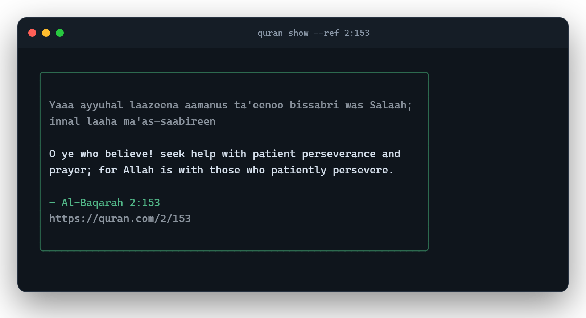
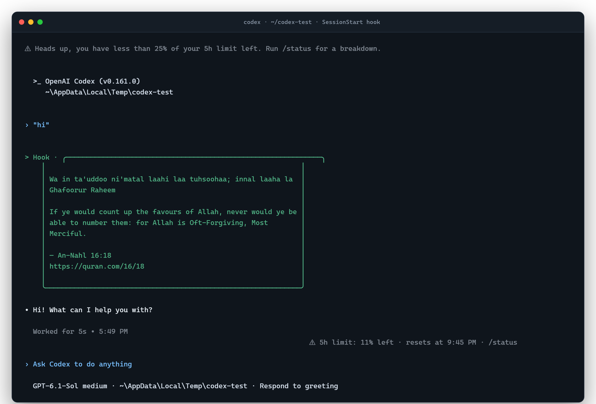
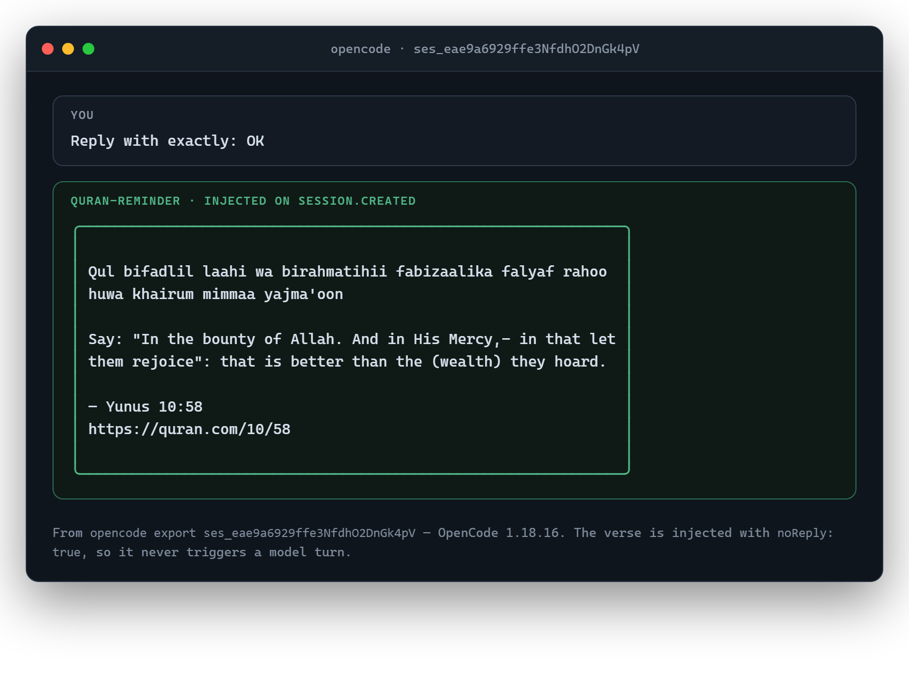
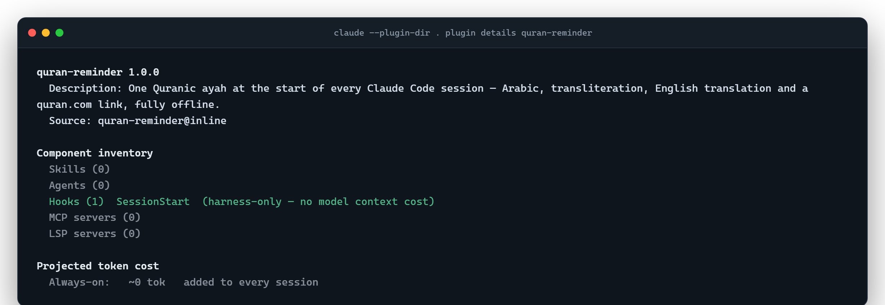
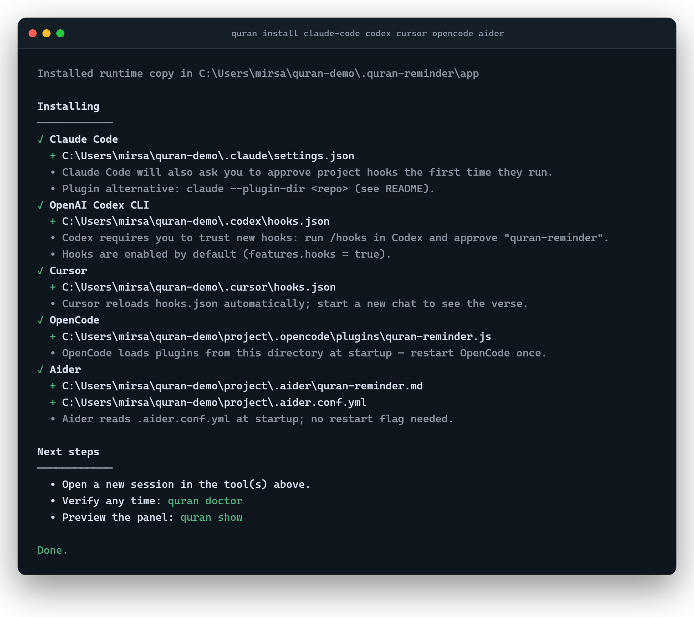
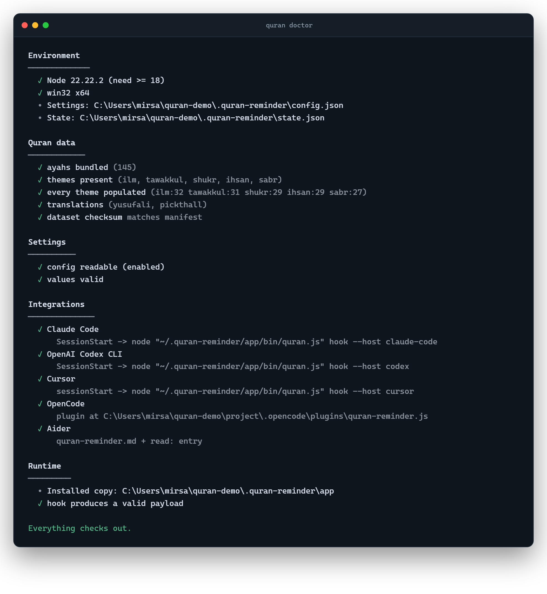

<p align="center">
  
</p>

<h1 align="center">quran-reminder</h1>

<p align="center">
  One ayah at the start of every coding session.<br/>
  <sub>Arabic · transliteration · English translation · surah reference · quran.com link</sub>
</p>

<p align="center">
  <a href="https://github.com/Sadat-Rakib/quran-reminder/actions/workflows/ci.yml"></a>
  <a href="LICENSE"></a>
  = 18" />
  
</p>

---

<p align="center">
  
</p>

## What it does

When you start a coding session, `quran-reminder` shows **one Quranic ayah** — then gets out of the way. No feed, no notifications, no interruptions mid-task.

It works with Claude Code, OpenAI Codex, Cursor, Gemini CLI, OpenCode, Windsurf, Antigravity, Cline, Roo Code, Aider, VS Code/GitHub Copilot, and any agent that reads `AGENTS.md` or speaks MCP.

- **One verse per session**, chosen from five themes based on the time of day
- **Never repeats** within a session, and avoids recent verses across sessions
- **Fully offline** — 145 curated ayahs bundled with the package, no network calls at runtime
- **Zero dependencies**, one `node` command, works on Windows, macOS and Linux
- **Private** — no telemetry, no accounts, no analytics. Ever.

## Screenshots

### Codex

<p align="center">
  
</p>

A live Codex 0.161 session. The `SessionStart` hook output appears as `Hook ·` above the first reply — no extra turn, no interruption.

### OpenCode

<p align="center">
  
</p>

OpenCode 1.18.16. The plugin injects the verse with `noReply: true` on `session.created`, so it lands in the conversation without triggering a model response. Captured from `opencode export`.

### Claude Code

<p align="center">
  
</p>

The plugin loads with exactly one `SessionStart` hook and **zero always-on tokens**.

### Install and verify

<p align="center">
  
</p>

<p align="center">
  
</p>

## Why

AI tools are fast and dense. Developers feel the pressure to match that pace.

This is a small counter to that: a moment of stillness at the start, grounded in something that has nothing to do with shipping code.

The Quran is meant to be read and reflected on — not consumed in passing. So it shows once, at the beginning, and gets out of the way.

## Supported tools

Legend:

| Mark | Meaning |
| :--: | ------- |
| ✅ | **Verified live** — installed and exercised in the real application on this machine; the reminder appeared in a real session. |
| 🟡 | **Hook-verified** — the tool's own loader/validator accepted the config, and the installed hook command was executed with that tool's documented payload. A live session in the app was not possible on the build machine (auth, plan, or the app is not installed). |
| 🔵 | **Context-only** — an instruction/rules file the tool reads. The verse reaches the model; it is not printed in your terminal. |
| ⚠️ | **Extra toggle or manual step** required. |

| Tool | Integration | Automatic? | Status |
| ---- | ----------- | ---------- | ------ |
| **Claude Code** | `SessionStart` hook in `~/.claude/settings.json`, plus a plugin manifest | Yes | 🟡 |
| **OpenAI Codex CLI** | `SessionStart` hook in `~/.codex/hooks.json` | Yes, in the interactive TUI after one-time `/hooks` trust | ✅ |
| **Cursor** | `sessionStart` hook in `~/.cursor/hooks.json` | Yes | 🟡 |
| **Gemini CLI** | `SessionStart` hook in `~/.gemini/settings.json` | Yes | 🟡 |
| **OpenCode** | Local plugin in `.opencode/plugins/` | Yes | ✅ |
| **Windsurf / Devin Desktop** | `pre_user_prompt` hook (Windsurf has no session-start event) | First prompt of a session | 🟡 |
| **Google Antigravity** | `SessionStart` hook in `.agents/hooks.json` | Yes (context injection) | 🟡 |
| **Cline** | `TaskStart` hook on macOS/Linux; rules file on Windows | Yes on Unix · context-only on Windows | 🟡 / 🔵 |
| **Roo Code** | `.roo/rules/quran-reminder.md` | Context-only | 🔵 |
| **Aider** | `.aider/quran-reminder.md` + `read:` in `.aider.conf.yml` | Context-only | 🔵 |
| **VS Code / GitHub Copilot** | `.github/instructions/quran-reminder.instructions.md` | Context-only | 🔵 |
| **Zed, Amp, and friends** | Managed block in `AGENTS.md` | Context-only | 🔵 |
| **Any MCP client** | `quran mcp` stdio server | On demand (model calls the tool) | 🟡 |

> **Honesty note:** this project does not claim more than it can prove. See [What was actually tested](#what-was-actually-tested) for the exact verification performed, and what still needs a live run in each app.

## Requirements

- **Node.js 18.17 or newer** (`node --version`)
- Windows 10/11, macOS 12+, or a modern Linux distribution
- Git (only if you install directly from GitHub)

No npm packages are installed. The plugin has zero dependencies.

## Quick start

Pick **one** of these two ways to run the installer.

**Option A — no global install (recommended for a first try):**

```bash
npx github:Sadat-Rakib/quran-reminder install
```

**Option B — install the command once, use it forever:**

```bash
npm install -g github:Sadat-Rakib/quran-reminder
quran install
```

Either command copies a stable runtime to `~/.quran-reminder/app`, detects the coding tools on your machine, and asks which ones to configure. Then:

```bash
quran show      # preview a verse in your terminal
quran doctor    # confirm everything is wired up
```

Open a new session in your editor or CLI. That's it.

> If you prefer to be explicit, pass the tools you want:
> `npx github:Sadat-Rakib/quran-reminder install claude-code cursor aider`
> Run `quran list` (or the installer without arguments) to see every supported id.

---

## Install for each tool

All commands below assume you either ran Option B (`quran` on your `PATH`) or prefix them with `npx github:Sadat-Rakib/quran-reminder`. For example:

```bash
npx github:Sadat-Rakib/quran-reminder install claude-code
```

By default, **hook-based tools are configured at the user level** (Antigravity uses the current project), and **instruction files are written to the current project**. Override with `--scope user` or `--scope project`. Existing settings are merged, never replaced, and every modified file gets a timestamped `.bak` next to it.

### Claude Code

```bash
quran install claude-code
```

This adds a `SessionStart` hook to `~/.claude/settings.json` (or `./.claude/settings.json` with `--scope project`). Claude Code asks you to approve new hooks the first time they run — approve it once.

**Verify:**

```bash
quran doctor          # shows: ✓ Claude Code — SessionStart -> ...
```

Then open a new Claude Code session. You should see the panel above the first prompt.

<details>
<summary>Alternative: install as a Claude Code plugin</summary>

The repository is also a valid Claude Code plugin and marketplace:

```text
/plugin marketplace add Sadat-Rakib/quran-reminder
/plugin install quran-reminder@quran-reminder
```

The manifests are validated with `claude plugin validate . --strict`. This route requires Claude Code's plugin marketplace feature; the CLI route above works everywhere.
</details>

### OpenAI Codex CLI

```bash
quran install codex
```

Writes `~/.codex/hooks.json`. Codex enables hooks by default.

**One-time trust step:** start Codex, run `/hooks`, and approve the `quran-reminder` hook. Codex intentionally refuses to run unreviewed hooks.

**Verify:** `quran doctor`, then start a new Codex session.

> `SessionStart` hooks run in the interactive Codex TUI. `codex exec` (non-interactive) does not fire them in Codex 0.161 — this was tested directly.

<p align="center"></p>

### Cursor

```bash
quran install cursor
```

Writes a `sessionStart` hook to `~/.cursor/hooks.json`. Cursor reloads hook files automatically.

**Verify:** `quran doctor`, then start a **new chat** (not a new tab in an existing chat).

> Cursor runs `sessionStart` as fire-and-forget: the verse is added to the new conversation's context, and Cursor may also show it as a message depending on your version. It never blocks the session.

### Gemini CLI

```bash
quran install gemini-cli
```

Writes `~/.gemini/settings.json`. Gemini fingerprints project-level hooks, so a changed command is re-confirmed once.

**Verify:** `quran doctor`, then run `gemini` in a new terminal.

### OpenCode

```bash
quran install opencode
```

Writes `.opencode/plugins/quran-reminder.js` in the current project (use `--scope user` for `~/.config/opencode/plugins/`). The plugin listens for `session.created`, fetches a verse, and injects it with `noReply: true` — the model sees it, no reply is triggered.

**Verify:**

```bash
quran doctor
opencode debug config   # should list quran-reminder.js under "plugin"
```

Restart OpenCode once after installing.

<p align="center"></p>

### Windsurf / Devin Desktop

```bash
quran install windsurf
```

Windsurf has **no session-start event**. This adapter uses `pre_user_prompt` with `show_output: true`, and de-duplicates per session, so you see the verse on the first prompt only.

Writes `~/.codeium/windsurf/hooks.json`.

**Verify:** `quran doctor`, then send your first message in a new Cascade session.

### Google Antigravity

```bash
quran install antigravity
```

Writes `.agents/hooks.json` in the current project (`--scope user` writes `~/.gemini/config/hooks.json`). The hook returns `injectSteps`, which Antigravity injects into the conversation at `SessionStart`.

**Verify:** `quran doctor`, then open the Hooks panel in Antigravity (Settings → Customizations → Hooks) and confirm `quran-reminder` is listed.

### Cline

```bash
quran install cline
```

- **macOS / Linux:** writes an executable `TaskStart` hook to `.clinerules/hooks/TaskStart`. Enable **Hooks** in Cline's Feature Settings.
- **Windows:** Cline does not support hooks on Windows, so the installer writes `.clinerules/quran-reminder.md` instead. The verse is context for the model, not terminal output.

**Verify:** `quran doctor`.

### Roo Code

```bash
quran install roo-code
```

Writes `.roo/rules/quran-reminder.md`. Roo Code loads every file in `.roo/rules/` at the start of a task.

**Verify:** `quran doctor`; the file should appear in Roo's rules list.

> This is context-only: Roo reads the verse, but does not print it in the UI. Run `quran refresh` to rotate the verse.

### Aider

```bash
quran install aider
```

Creates `.aider/quran-reminder.md` and adds it to the `read:` list in `.aider.conf.yml` (creating the file if needed). Aider loads `read:` files as read-only context at startup.

**Verify:**

```bash
quran doctor
cat .aider.conf.yml     # read: should include .aider/quran-reminder.md
```

> Context-only. Aider has no hook system. For a printed verse, launch Aider through the wrapper: `quran run aider`.

### VS Code / GitHub Copilot

```bash
quran install vscode-copilot
```

Writes `.github/instructions/quran-reminder.instructions.md` with `applyTo: '**'`. VS Code 1.102+ discovers instruction files automatically.

**Verify:** open Copilot Chat, run a small request, and expand **References** — the instruction file should be listed. `quran doctor` also confirms the file.

> Context-only. To see the panel in a terminal, use `quran show` or `quran run <command>`.

### Any agent that reads AGENTS.md

```bash
quran install agents-md
```

Adds a marker-delimited block to `AGENTS.md` in the current project:

```markdown
<!-- quran-reminder:start -->
...
<!-- quran-reminder:end -->
```

Everything outside the markers is preserved byte for byte. Codex, Cursor, Copilot, Gemini CLI, OpenCode, Zed, Amp and others read this file.

**Verify:** `quran doctor`, or `grep -n "quran-reminder" AGENTS.md`.

> `agents-md` is **not** included in `--all`, because it edits a file your whole team shares. Install it explicitly.

### Any MCP client

For clients that support MCP but not hooks (Claude Desktop, Zed, custom agents), run the bundled stdio server:

```json
{
  "mcpServers": {
    "quran-reminder": {
      "command": "node",
      "args": ["<HOME>/.quran-reminder/app/bin/quran.js", "mcp"]
    }
  }
}
```

Replace `<HOME>` with your home directory (`~` is not expanded inside JSON on all clients). Two tools are exposed:

- `quran_ayah` — one ayah, with optional `theme`, `translation` and `format`
- `quran_themes` — the five themes and their pool sizes

**Verify** without a client:

```bash
printf '%s\n' '{"jsonrpc":"2.0","id":1,"method":"initialize","params":{}}' \
  '{"jsonrpc":"2.0","id":2,"method":"tools/list"}' \
  | node ~/.quran-reminder/app/bin/quran.js mcp
```

You should get two JSON responses.

---

## Verify your installation

```bash
quran doctor
```

It checks Node, the bundled dataset and checksum, your settings, every installed integration, and runs the hook once to confirm it produces a valid payload:

```text
Environment
─────────────
  ✓ Node 22.12.0 (need >= 18)
  ✓ linux x64
  • Settings: /home/you/.quran-reminder/config.json

Quran data
────────────
  ✓ ayahs bundled (145)
  ✓ themes present (ilm, tawakkul, shukr, ihsan, sabr)
  ✓ dataset checksum matches manifest

Integrations
──────────────
  ✓ Claude Code
      SessionStart -> "…/node" "…/bin/quran.js" hook --host claude-code
  ✓ Cursor
      sessionStart -> "…/node" "…/bin/quran.js" hook --host cursor

Everything checks out.
```

## Example output

```console
$ quran show --theme sabr

╭──────────────────────────────────────────────────────────────╮
│                                                              │
│ Yaaa ayyuhal laazeena aamanus ta'eenoo bissabri was Salaah;  │
│ innal laaha ma'as-saabireen                                  │
│                                                              │
│ O ye who believe! seek help with patient perseverance and    │
│ prayer; for Allah is with those who patiently persevere.     │
│                                                              │
│ — Al-Baqarah 2:153                                           │
│ https://quran.com/2/153                                      │
│                                                              │
╰──────────────────────────────────────────────────────────────╯
```

Other formats:

```bash
quran show --format plain       # no box, good for logs
quran show --format markdown    # for notes and PRs
quran show --format json        # machine-readable
quran show --arabic             # include the Arabic text
quran show --translation pickthall
quran show --ref 2:153          # a specific verse
```

## Configuration

Settings live in `~/.quran-reminder/config.json`. Use the CLI so values are validated:

```bash
quran config list
quran config set theme sabr
quran config set translation pickthall
quran config set frequency daily
quran config set showArabic true
quran config set width 72
quran config set enabled false
quran config reset
```

| Key | Values | Default | Meaning |
| --- | ------ | ------- | ------- |
| `enabled` | `true` / `false` | `true` | Master switch |
| `theme` | `auto`, `ilm`, `tawakkul`, `shukr`, `ihsan`, `sabr`, `random` | `auto` | `auto` follows the clock |
| `translation` | `yusufali`, `pickthall` | `yusufali` | English translation |
| `frequency` | `session`, `daily`, `hourly`, `always` | `session` | How often a reminder may appear |
| `injectContext` | `true` / `false` | `true` | Also give the verse to the model |
| `showArabic` | `true` / `false` | `false` | Arabic line in the panel |
| `showTransliteration` | `true` / `false` | `true` | Transliteration line |
| `showTranslation` | `true` / `false` | `true` | English translation |
| `showLink` | `true` / `false` | `true` | quran.com link |
| `color` | `auto`, `always`, `never` | `auto` | ANSI colors |
| `width` | `40`–`120` | `64` | Panel width |
| `avoidDays` | `0`–`365` | `3` | Don't repeat a verse shown in the last N days |

Environment variables:

| Variable | Effect |
| -------- | ------ |
| `QURAN_REMINDER_DISABLE=1` | Disable reminders without editing config |
| `QURAN_REMINDER_THEME=sabr` | Override the theme for this process |
| `QURAN_REMINDER_TRANSLATION=pickthall` | Override the translation |
| `NO_COLOR=1` | Disable colors ([no-color.org](https://no-color.org/)) |
| `QURAN_REMINDER_DEBUG=1` | Print hook diagnostics to stderr |
| `QURAN_REMINDER_HOME=/path` | Store settings/state somewhere else |
| `QURAN_REMINDER_DATA=/path/ayahs.json` | Use a custom dataset |

### Themes

| Theme | Meaning | Time window |
| ----- | ------- | ----------- |
| `ilm` | Knowledge, learning, reflection, intention | 04:00–08:59 |
| `tawakkul` | Reliance on Allah, effort, trust | 09:00–16:59 |
| `shukr` | Gratitude, remembrance, blessings | 17:00–03:59 |
| `ihsan` | Excellence, character, mercy, speech | any (opt-in) |
| `sabr` | Patience, perseverance, hardship | any (opt-in) |

## Commands

| Command | What it does |
| ------- | ------------ |
| `quran` | Show one ayah |
| `quran show [options]` | Show one ayah with options |
| `quran install [tool…]` | Install for one or more tools (interactive if omitted) |
| `quran uninstall [tool…]` | Remove the integration (`--purge` also deletes settings) |
| `quran list` | Supported tools, detection and install status |
| `quran doctor` | Verify data, settings, integrations and the hook |
| `quran config …` | `list`, `get`, `set`, `reset` |
| `quran themes` | Theme names, pool sizes and time windows |
| `quran refresh` | Rotate the verse in static instruction files |
| `quran run <command…>` | Print a verse, then run any command |
| `quran mcp` | Start the MCP stdio server |

## How it works

1. The tool fires its session-start event and pipes a JSON payload to
   `node ~/.quran-reminder/app/bin/quran.js hook --host <tool>`.
2. The hook resolves a session id from that payload, checks your `frequency`
   setting, and stops silently if a reminder was already shown.
3. A theme is chosen from the local clock (or your config), then one ayah is
   picked from that theme's pool, skipping verses shown recently.
4. The verse is rendered for that host — a boxed panel for terminals, JSON
   `additionalContext` for Claude Code/Codex/Gemini, `injectSteps` for
   Antigravity, and so on.
5. The session id and verse reference are recorded in
   `~/.quran-reminder/state.json` so it will not repeat.
6. Every failure path is silent and exits `0`. A broken reminder must never
   break your session.

## Project structure

```text
quran-reminder/
├── bin/quran.js              # CLI entry point
├── src/
│   ├── hook.js               # universal session-start hook
│   ├── core/
│   │   ├── config.js         # settings + validation
│   │   ├── data.js           # bundled dataset loader
│   │   ├── select.js         # theme + no-repeat selection
│   │   ├── render.js         # panel / plain / markdown / JSON renderers
│   │   ├── state.js          # per-session history
│   │   ├── fsutil.js         # safe, non-destructive file edits
│   │   └── installer.js      # self-install + adapter orchestration
│   ├── adapters/             # one file per supported tool
│   └── mcp/server.js         # zero-dependency MCP stdio server
├── data/
│   ├── curated.js            # human-maintained refs + themes
│   ├── ayahs.json            # generated, committed dataset
│   └── manifest.json         # checksum + counts
├── scripts/                  # build:data, verify:data
├── docs/screenshots/         # README images (captured from real sessions)
├── tests/                    # node:test suite (84 tests)
├── hooks/hooks.json          # Claude Code plugin hook
└── .claude-plugin/           # Claude Code plugin + marketplace manifests
```

## What was actually tested

This section is deliberately specific, so you know exactly what you are trusting.

**Automated (every commit, every OS in CI):**

- **84 tests, all passing** locally on Windows 11 (Node 22) and in CI on Ubuntu, macOS and Windows × Node 18, 20 and 22.
- Dataset integrity: 145 unique ayahs, every reference within its surah's canonical length, Arabic present, both translations present, no HTML leakage, checksum matches `manifest.json`.
- Rendering: panels are rectangular at every width, wrapping never exceeds the width, narrow terminals fall back to plain text, colors are opt-out.
- Selection and state: time-of-day boundaries, no-repeat within a session, exhaustion fallback, daily/hourly/session frequencies, corrupt state files.
- Adapters: install → verify → uninstall for **all 12 integrations**, preserving pre-existing JSON keys, hooks and markdown content; idempotent re-installs; refusal to touch invalid JSON.
- Hook: every host output shape, garbage/empty/200 KB stdin, missing session ids, exit code `0` in all cases.
- CLI: install/uninstall/doctor/config/show end to end in an isolated home.
- MCP: initialize, `tools/list`, `tools/call`, error codes, and a real stdio handshake.

**Manual, on the build machine (Windows 11, Node 22.22):**

- `claude plugin validate . --strict` — marketplace and plugin manifests pass; `claude --plugin-dir . plugin details quran-reminder` loads the plugin and reports **1 SessionStart hook**. A live Claude session could not be run because the local OAuth session had expired.
- `codex doctor` — Codex reported a healthy configuration with the generated `~/.codex/hooks.json` in place.
- **OpenAI Codex CLI, live (v0.161.0, Windows):** installed into the real `~/.codex/hooks.json` and ran the interactive Codex TUI under a pseudo-terminal. Codex executed `SessionStart`, passed the documented payload (`session_id`, `transcript_path`, `cwd`, `model`), rendered the verse panel in the TUI, and `~/.quran-reminder/state.json` recorded the verse. **Caveat:** `codex exec` (non-interactive) does **not** run `SessionStart` hooks in 0.161 — tested with both `hooks.json` and inline `[hooks]` TOML — so the integration is TUI-only for now.
- **OpenCode, live (v1.18.16, Windows):** real `opencode run` sessions loaded `.opencode/plugins/quran-reminder.js`, fired `session.created`, and injected the verse with `noReply: true`. The injected panel is present in `opencode export` (`— Yunus 10:58`, `https://quran.com/10/58`) and in the state file. The model reply itself failed because the local OpenCode API key had expired, so we could not observe the assistant reading it.
- The exact command written into each hook config was executed with that tool's documented stdin payload, and its output parsed — for Claude Code, Codex, Gemini CLI, Cursor, Windsurf and Antigravity.
- `npm run verify:data` — sampled ayahs re-fetched from quran.com and alquran.cloud; Arabic, both translations, transliteration and surah names matched exactly.

**Not verified here (please treat as untested until you try it):**

- A live, authenticated session in Claude Code, Cursor, Gemini CLI, Windsurf, Antigravity, Cline, Roo Code or Aider on this machine.
- Gemini CLI, Windsurf, Aider, Cline and Roo Code are **not installed** on the build machine; their configs follow the vendors' published schemas but were not loaded by the real apps.
- The editors and CLIs themselves were not launched on macOS or Linux. CI does run the full installer, `doctor` and uninstall flow on all three operating systems, plus the hook payload check.
- Cline's `TaskStart` hook path was tested only on Windows, where Cline uses the rules file instead.

If an integration does not work for you, please open an issue with `quran doctor` output and the tool version. That is how the 🟡 rows become ✅.

## Troubleshooting

**The hook runs but I see nothing.**

- Claude Code: approve the hook when prompted, then restart the session.
- Codex: run `/hooks` and trust `quran-reminder`; Codex does not run untrusted hooks. Note that `codex exec` (non-interactive) does not run `SessionStart` hooks at all in 0.161 — use the interactive `codex` TUI.
- Cursor: start a **new chat**; `sessionStart` fires per conversation, not per tab.
- Cline: enable **Hooks** in Cline's feature settings.
- Check the plumbing: `QURAN_REMINDER_DEBUG=1 quran doctor`.

**It shows a verse every single prompt.**

Your `frequency` is probably `always`. Set `quran config set frequency session`.

**I installed with `npx` and later the hook stopped working.**

`npx` caches packages in a directory npm may prune. Re-run the installer; it keeps a stable copy at `~/.quran-reminder/app` and points hooks there. If you switched Node versions, run `quran install --force` so the absolute `node` path is refreshed.

**The Arabic looks broken in my terminal.**

Terminal bidi support varies. Leave `showArabic` off (the default) and use the transliteration + translation, or open the quran.com link.

**Aider/Copilot/Roo show no output.**

Those integrations are context-only by design — they have no hook system. Use `quran run aider` or `quran show` if you want the panel printed.

**Windows: "running scripts is disabled".**

The hook calls `node` directly with quoted absolute paths, so no `.ps1` is involved. If you still hit policy errors, check your organisation's execution policy; `quran doctor` will tell you whether the hook itself runs.

**I want different verses.**

Edit `data/curated.js`, then:

```bash
npm run build:data     # re-fetch text for the curated references
npm run verify:data    # spot-check against upstream
npm test
quran install --force  # refresh the installed copy
```

## Uninstall

```bash
quran uninstall                 # interactive: pick installed tools
quran uninstall claude-code cursor
quran uninstall --all
```

Uninstalling removes **only** the entries and files this project created. Your other hooks, settings and markdown content are left untouched. Backups created during install are not deleted automatically.

To remove settings, state and the runtime copy as well:

```bash
quran uninstall --all --purge
```

## Credits

This project was inspired by [claude-code-quran](https://github.com/AhsanAyaz/claude-code-quran) by **Ahsan Ayaz**.

The original project beautifully brings Quranic reminders into Claude Code. However, many developers use other AI coding assistants, free tools, and IDEs.

I wanted to take that idea further and make it accessible to developers across different coding environments.

Regardless of which coding assistant you use, I hope this project brings a meaningful reminder into your development workflow.

The five themes (`ilm`, `tawakkul`, `shukr`, `ihsan`, `sabr`), the time-of-day selection idea and the framed terminal panel are carried over from the original. The adapter architecture, dataset pipeline, CLI and tests are new. See [ATTRIBUTION.md](ATTRIBUTION.md) for details.

Quran text and translations are sourced from [quran.com](https://quran.com) and [alquran.cloud](https://alquran.cloud); the bundled translations are A. Yusuf Ali and M. Pickthall, both in the public domain. See [data/SOURCES.md](data/SOURCES.md).

## Contributing

Contributions are welcome — especially new adapters and real-world verification reports. Start with [CONTRIBUTING.md](CONTRIBUTING.md).

```bash
git clone https://github.com/Sadat-Rakib/quran-reminder
cd quran-reminder
npm test
```

No `npm install` is required: the project has zero dependencies.

## License

[MIT](LICENSE) © Sadat Rakib
